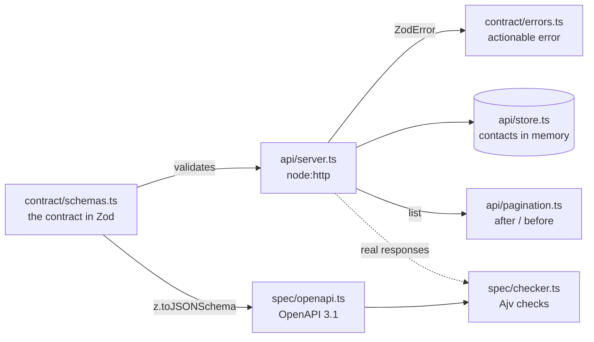

# contacts-api

[](https://github.com/<your-github-user>/contacts-api/actions/workflows/ci.yml)

A small public REST API for contacts, written in TypeScript on `node:http`, designed the way a developer platform
designs its API: one Zod contract that validates requests and responses, errors that say what to do, cursor
pagination, an OpenAPI 3.1 document generated from the same schemas, and a contract test that checks real
responses against that document.

I built it to see, with numbers, why the "boring" API decisions (error shape, pagination, a single source of truth)
are the ones that decide whether SDKs, docs and integrations keep working.

```
1000 contacts · limit 50 · newest first · writes between pages
│ (index) │ strategy │ writes per page │ pages │ received │ duplicates │ skipped │
│ 2       │ 'offset' │ '+5 −2'         │ 22    │ 1063     │ 81         │ 0       │
│ 3       │ 'cursor' │ '+5 −2'         │ 20    │ 983      │ 0          │ 0       │
│ 4       │ 'offset' │ '+0 −10'        │ 17    │ 840      │ 0          │ 62      │
│ 5       │ 'cursor' │ '+0 −10'        │ 19    │ 901      │ 0          │ 0       │
```

Exporting a list while other clients write to it: offset pagination duplicates and skips contacts, the cursor does not.

## What's inside

- **One contract in Zod**: the create request (`z.strictObject`, so a misspelled field is an error), the `Contact`
  response, the list envelope `{ object: 'list', has_more, data }` and a single error shape
  `{ statusCode, name, message }`. Field names are snake_case.
- **Actionable errors**: a `ZodError` becomes a stable `name` (`missing_required_field`, `validation_error`…) and a
  message that tells the caller what to do: ``Missing required field `email`. Add it to the request body.``
- **The API on `node:http`**, no framework: `POST /contacts`, `GET /contacts`, `GET /contacts/{id}` and
  `DELETE /contacts/{id}`, with 400, 401, 404, 405, 422 and a generic 500 all in the same shape. Responses also go
  through their schema, so internal fields never leak.
- **Cursor pagination** with `limit` (1 to 100), `after` or `before` (never both), as pure functions, next to the
  offset version it replaces.
- **OpenAPI 3.1 generated from the schemas** with `z.toJSONSchema`: requests with `io: "input"`, responses with
  `io: "output"`, and `$ref` between components.
- **Contract test**: [Ajv](https://ajv.js.org) (not Zod) validates real responses against the published document,
  and catches a renamed field, an undeclared status or an error outside the standard shape.
- **Benchmark**: offset versus cursor while other clients create and delete contacts between pages.

## Architecture



The code is split in three layers: **contract** says what goes in and out, **api** serves it over HTTP, and
**spec** publishes the contract and proves the server keeps it. Everything starts from `contract/schemas.ts`: the
server validates with it and the OpenAPI document is generated from it, so code and docs cannot drift apart.

## Quick start

Requires Node.js 20 or newer.

```bash
npm install
npm test               # 27 tests
npm run validation     # what Zod returns for bad requests, and input vs output JSON Schema
```

## Examples

| Command | What you see |
|---|---|
| `npm run validation` | Raw Zod issues for five request bodies, and why `required` differs between input and output |
| `npm run openapi` | Writes `openapi.json` and prints a summary of the operations and schemas |
| `npm run bench` | Offset versus cursor while other clients create and delete contacts between pages |
| `npm run check-env` | Node version, Zod 4 and the seeded random generator |

## Project layout

```
src/
  contract/    schemas.ts (the Zod contract), errors.ts (ZodError → actionable API error)
  api/         store.ts (in memory), pagination.ts (offset and cursor), server.ts (node:http)
  spec/        openapi.ts (OpenAPI 3.1 from Zod), checker.ts (Ajv contract checker)
  testing/     seeded random and a tiny HTTP client: used by tests and the benchmark only
  index.ts     public API
examples/      one runnable script per concept
bench/         offset vs cursor
scripts/       environment check, OpenAPI generation
```

Tests live next to the code they test (`server.ts` and `server.test.ts`).

## Design decisions

- **One source of truth.** The Zod schemas validate requests, validate responses, type the handlers and become the
  OpenAPI document. Only routes and status codes are written by hand, because they are design decisions.
- **The error name is the contract, the message is for people.** Clients branch on `name` and the status; the
  message can improve at any time. It names the field, says what to do and, for an unknown field, lists the
  accepted ones, so a developer (or an agent) fixes the request on the next try.
- **All missing fields at once.** Reporting only the first one makes the caller fix, retry and fail again.
- **Cursor = the item's id, sorting by an internal `seq`.** The position is the item, not a number, so inserts and
  deletes do not shift it. The store remembers the `seq` of deleted contacts, so a cursor pointing to one still works.
- **Input and output are different views of one schema.** `unsubscribed` has a default: optional when sending,
  always present when reading. Requests are generated with `io: "input"`, responses with `io: "output"`.
- **The contract test uses another validator.** Whoever consumes the spec does not run our Zod, so Ajv checks the
  published document against real HTTP responses.
- **Local and reproducible.** The server listens on `127.0.0.1`, port 0, and the benchmark uses seeded randomness:
  nothing leaves the machine, and the numbers are the same on every run.

## Limitations

This is a learning project: the store lives in memory, the API key check only looks at the format, there is no
rate limiting, no idempotency keys and no versioning. The "after or before, not both" rule lives in a `.refine` and
does not show up in the OpenAPI document. Each of these is a good next step.

## References

[OpenAPI 3.1](https://spec.openapis.org/oas/v3.1.0) ·
[JSON Schema 2020-12](https://json-schema.org/draft/2020-12) ·
[Zod: JSON Schema](https://zod.dev/json-schema) ·
[Ajv](https://ajv.js.org) ·
[Resend API reference](https://resend.com/docs/api-reference/introduction) ·
[Google AIP-158: pagination](https://google.aip.dev/158)

## License

[MIT](LICENSE)
